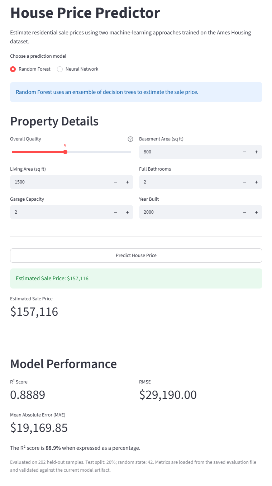
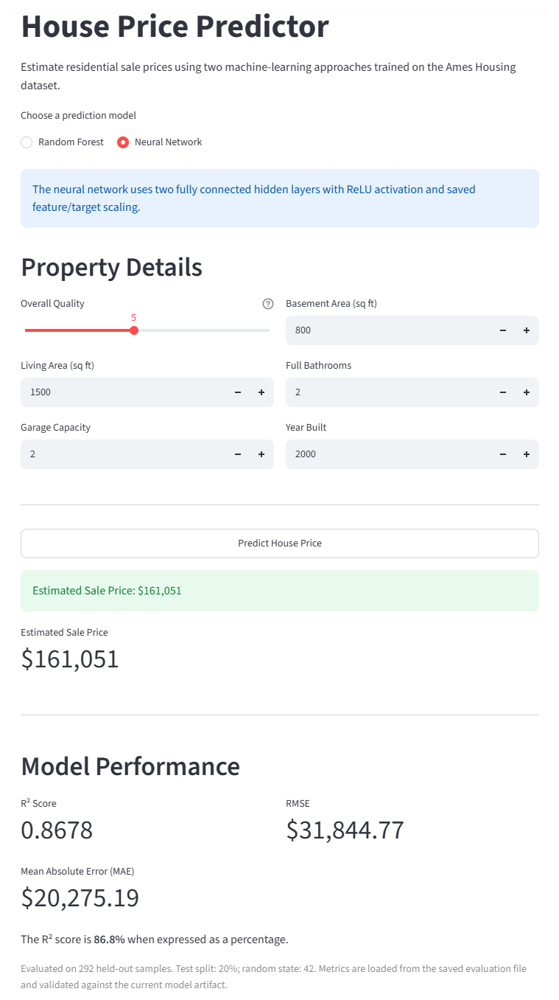
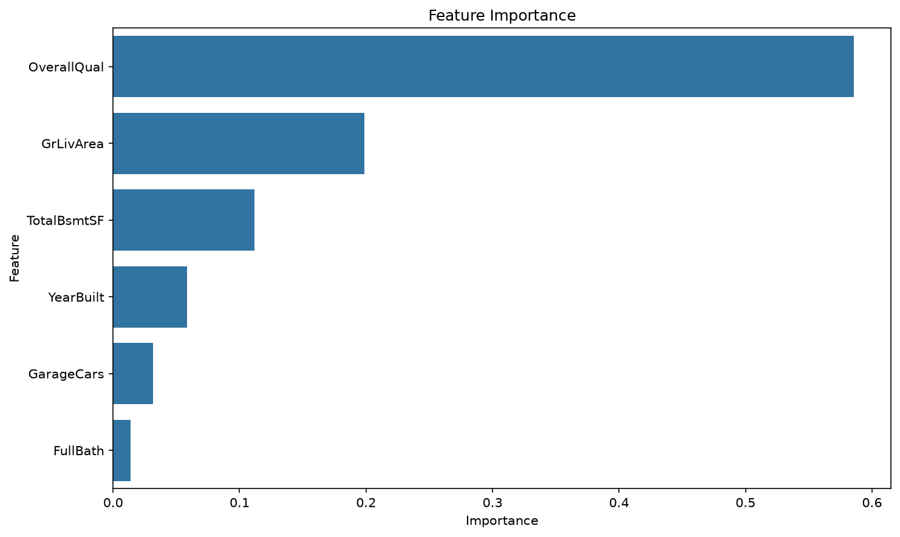

# House Price Prediction

An end-to-end machine learning portfolio project that predicts residential house sale prices using two regression approaches: a Scikit-learn Random Forest and a neural network implemented with NumPy. The project includes data validation, model training, evaluation, automated testing, feature importance analysis, and an interactive Streamlit application.

## Live Demo

Try the deployed Streamlit application:

[House Price Prediction — Streamlit](https://house-price-prediction-vrtvevjqxqm7yuhvyx7z7v.streamlit.app/)

## Screenshots

The Streamlit application with the same example property entered for each model:

| Random Forest | Neural Network |
|:---:|:---:|
|  |  |

Example property: overall quality 5, living area 1,500 sq ft, garage capacity 2, basement area 800 sq ft, 2 full bathrooms, built in 2000. Beneath each estimate, the app shows the recorded test-set metrics of the selected model.

## Overview

This project uses the Ames Housing dataset to predict residential sale prices from six selected property features.

The project demonstrates an end-to-end machine learning workflow:

- Data loading and validation
- Feature selection and preprocessing
- Reproducible train/test splitting
- Random Forest regression
- Neural network implementation and training
- Evaluation against a mean-prediction baseline
- Feature importance analysis
- Model serialization and loading
- Model-specific evaluation-metrics persistence
- Automated testing
- Interactive web application development

## Features

Both models use the same six input features:

| Feature | Description |
|---|---|
| `OverallQual` | Overall material and finish quality |
| `GrLivArea` | Above-ground living area |
| `GarageCars` | Garage capacity |
| `TotalBsmtSF` | Total basement area |
| `FullBath` | Number of full bathrooms |
| `YearBuilt` | Original construction year |

These features provide a compact representation of important property characteristics while keeping the application straightforward to use.

## Machine Learning Models

### 1. Random Forest Regressor

The Random Forest model uses Scikit-learn with a preprocessing pipeline.

The training workflow:

1. Loads and validates the dataset.
2. Selects the six input features and `SalePrice` target.
3. Handles missing numerical feature values using median imputation.
4. Splits the data into training and test sets.
5. Trains the Random Forest regressor.
6. Evaluates predictions on the held-out test set.
7. Generates a feature importance plot.
8. Saves the trained pipeline to `models/model.pkl`.
9. Saves evaluation metrics to `models/random_forest_metrics.json`.

Training configuration:

- `n_estimators = 300`
- `max_depth = 12`
- `random_state = 42`
- `n_jobs = -1`

### 2. Neural Network

The second model is a fully connected neural network implemented using NumPy rather than a deep-learning framework.

Architecture:

- Input layer: 6 features
- First hidden layer: 32 neurons with ReLU activation
- Second hidden layer: 16 neurons with ReLU activation
- Output layer: 1 predicted sale price

The implementation includes:

- He-style weight initialization for ReLU hidden layers
- Mini-batch gradient descent
- Mean squared error loss
- Feature and target standardization
- Validation-based early stopping
- Restoration of the best validation weights
- Model parameter serialization in NumPy's `.npz` format
- Input and artifact validation during inference

The training workflow uses separate training, validation, and test subsets. Scaling parameters are calculated from the training subset to avoid using validation or test information during preprocessing.

The trained model is saved to `models/neural_network.npz`, and its evaluation metrics are saved to `models/neural_network_metrics.json`.

## Model Performance

The following results are from the latest recorded training runs in the development environment.

| Metric | Random Forest | Neural Network |
|---|---:|---:|
| Test R² | 0.8889 | 0.8678 |
| Test RMSE | $29,190.00 | $31,844.77 |
| Test MAE | $19,169.85 | $20,275.19 |

Both models use the same 20% held-out test split with `random_state = 42`. The neural network additionally uses a validation subset drawn from the training portion.

The Random Forest has the better recorded R² and lower RMSE and MAE in these runs. These results describe performance on this dataset and split; they do not establish that the same model will perform better on every dataset.

The training scripts save the evaluation metrics as JSON files. The Streamlit application loads the metrics associated with each model artifact instead of relying on hard-coded evaluation values. Each metrics file includes a SHA-256 digest of its model artifact, allowing the application to reject metrics that no longer match the corresponding model file.

If evaluation metrics are missing or do not match their model artifact, the application can still make predictions when the model itself is available, but it warns that the evaluation metrics are unavailable or outdated.

### R² Score

R² measures how much variation in the target values is explained by a model relative to a mean-prediction baseline. A score closer to 1 generally indicates better predictive performance.

### Root Mean Squared Error

RMSE measures prediction error in the target's units—in this case, dollars. It penalizes larger errors more heavily than smaller ones.

### Mean Absolute Error

MAE measures the average absolute difference between predicted and actual sale prices. It is expressed in dollars and is less sensitive to large individual errors than RMSE.

## Baseline Comparison

The neural network training script also evaluates a baseline that predicts the mean sale price of the training subset for every test example.

Latest recorded baseline results:

| Metric | Mean Baseline |
|---|---:|
| Test R² | -0.0008 |
| Test RMSE | $87,613.78 |

The neural network substantially outperforms this baseline on the recorded test split. A baseline provides useful context by showing whether a trained model improves on a simple prediction strategy.

## Random Forest Feature Importance

The Random Forest model generates a feature importance visualization saved to `feature_importance.png`.



Latest recorded feature importance values:

| Feature | Importance |
|---|---:|
| Overall Quality | 58.6% |
| Living Area | 19.8% |
| Basement Area | 11.2% |
| Year Built | 5.8% |
| Garage Capacity | 3.2% |
| Full Bathrooms | 1.4% |

Overall quality has the highest feature importance in the trained Random Forest, followed by above-ground living area and basement area.

Feature importance measures how the fitted Random Forest uses features to reduce impurity. It does not establish causation and should not be interpreted as the effect of changing a property characteristic.

These figures reflect a particular training run and may change when the data, features, or model configuration changes.

## Streamlit Application

The Streamlit interface lets users select a model and enter the six property characteristics to receive an estimated sale price.

The application provides:

- Random Forest and neural network prediction options
- Input controls for all six features
- Estimated sale price
- Model evaluation metrics loaded from saved JSON files
- Random Forest feature importance chart, shown below the metrics whichever model is selected (the neural network has no feature-importance view)
- Project information and model descriptions
- Model-loading and prediction error handling
- Warnings when evaluation metrics are missing or do not match their model artifacts

The two model artifacts and their evaluation metrics are stored separately, allowing each model to be loaded and evaluated independently.

## Project Structure

```text
house-price-prediction/
├── app.py
├── model_metrics.py
├── train.py
├── neural_network.py
├── train_neural_network.py
├── requirements.txt
├── README.md
├── .gitignore
├── feature_importance.png
├── images/
│   ├── streamlit_random_forest.png
│   └── streamlit_neural_network.png
├── data/
│   └── train.csv
├── models/
│   ├── model.pkl
│   ├── random_forest_metrics.json
│   ├── neural_network.npz
│   └── neural_network_metrics.json
└── tests/
    └── test_app.py
```

Generated model artifacts and evaluation metrics are produced by the training scripts. The dataset must be available separately at `data/train.csv`.

## Technologies

- Python
- Pandas
- NumPy
- Scikit-learn
- Matplotlib
- Seaborn
- Streamlit
- Pytest
- Git and GitHub

## Dataset

This project uses the **House Prices: Advanced Regression Techniques** dataset from Kaggle.

The dataset contains residential property information from Ames, Iowa, including property quality, size, construction characteristics, and other attributes.

The expected training file is `data/train.csv`. The training scripts do not download or recreate the dataset. Obtain it from the original [Kaggle dataset](https://www.kaggle.com/competitions/house-prices-advanced-regression-techniques/data) if it is not already present.

The dataset must contain the six selected features and the `SalePrice` target.

## How to Run the Project

### 1. Clone the repository

```bash
git clone https://github.com/Parisa-lab/house-price-prediction.git
cd house-price-prediction
```

### 2. Install dependencies

Use Python 3.11 or newer (required by the pinned `scikit-learn==1.9.1`) and install the project dependencies:

```bash
python -m pip install -r requirements.txt
```

### 3. Prepare the dataset

Place the Kaggle training file at:

```text
data/train.csv
```

Ensure that the file contains all six selected features and the `SalePrice` target.

### 4. Train the Random Forest model

```bash
python train.py
```

This command trains and evaluates the Random Forest pipeline, generates the feature importance plot, and saves the following artifacts:

```text
models/model.pkl
models/random_forest_metrics.json
feature_importance.png
```

The metrics JSON records the evaluation results, test configuration, model details, and SHA-256 digest of the saved model artifact.

### 5. Train the neural network

```bash
python train_neural_network.py
```

This command validates the selected data, creates training, validation, and test subsets, trains the neural network, evaluates its performance against the mean baseline, and saves:

```text
models/neural_network.npz
models/neural_network_metrics.json
```

The metrics file is associated with the exact saved neural network artifact.

### 6. Run automated tests

Install Pytest if it is not already available:

```bash
python -m pip install pytest
```

Run the test suite from the repository root:

```bash
python -m pytest -v
```

The current development test suite has passed all 12 tests. The tests cover model artifacts, feature order, finite predictions, Random Forest feature importances, neural network input validation, missing-model handling, and evaluation-metrics persistence and validation.

Test results may vary if the source code, dependencies, or model artifacts change.

### 7. Run the Streamlit application

```bash
python -m streamlit run app.py
```

The application will display a local URL in the terminal. Open that URL in your browser.

The application expects the model artifacts to exist in the `models/` directory. If evaluation metrics are missing or invalid, retrain the relevant model using its training script.

## Limitations

### Limited Feature Set

The original dataset contains many more variables than the six features used in this project. Additional features may improve predictions but would require corresponding preprocessing, training, testing, and application changes.

### Dataset and Evaluation

The reported results use a single train/test split. Cross-validation and evaluation on additional data would provide stronger evidence about generalization.

### Model Comparison

The two models use different learning approaches and training procedures. A single held-out split provides a useful initial comparison but does not establish which approach is consistently superior.

### Real-World Use

Predictions are intended for educational and portfolio purposes. They are not professional real-estate valuations and should not be used as the sole basis for financial decisions.

## Future Improvements

- Cross-validation and repeated experiments
- Hyperparameter tuning
- Additional regression models
- Feature engineering and target transformations
- Model explainability methods
- Prediction intervals and uncertainty estimates
- Expanded automated tests
- Continuous integration and deployment
- Monitoring for changes in data and model performance

## Portfolio Project Workflow

```text
Dataset
   |
Feature Selection and Validation
   |
Train / Validation / Test Splits
   |
   +-------------------------+
   |                         |
Random Forest          NumPy Neural Network
   |                         |
Evaluation              Evaluation
   |                         |
Saved Pipeline          Saved Parameters
   |                         |
Saved Metrics           Saved Metrics
   |                         |
   +------------+------------+
                |
       Streamlit Application
                |
      Interactive Predictions
```

## Author

Parisa Barzegarisorkheh

AI and Data Science portfolio project.
